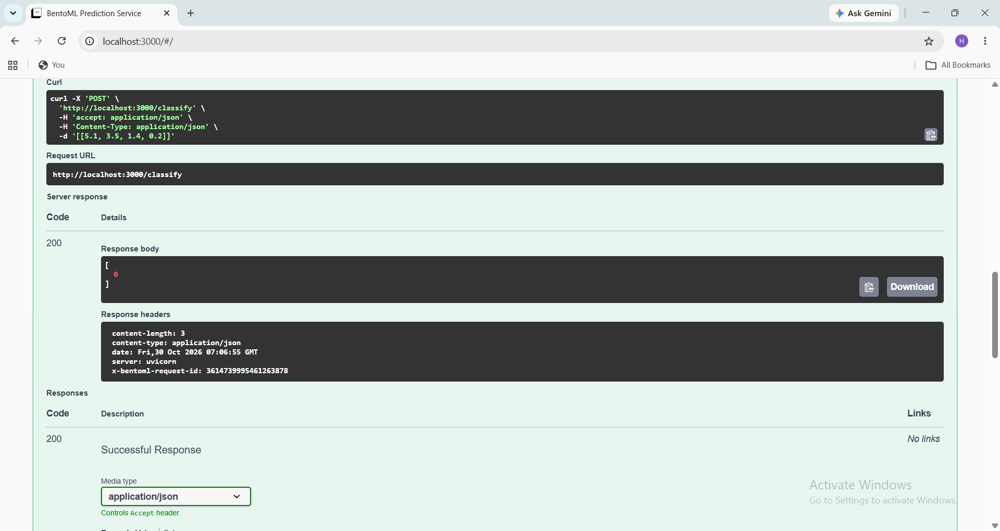
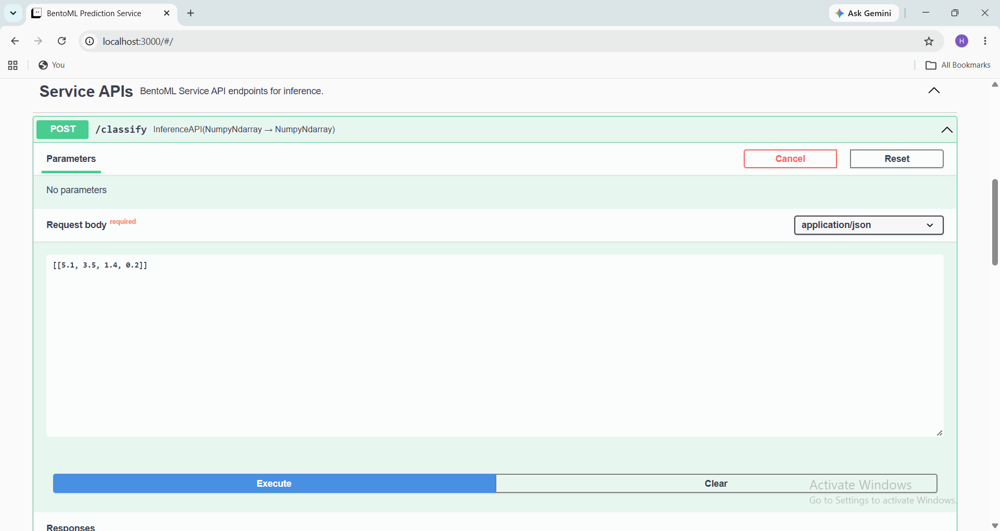
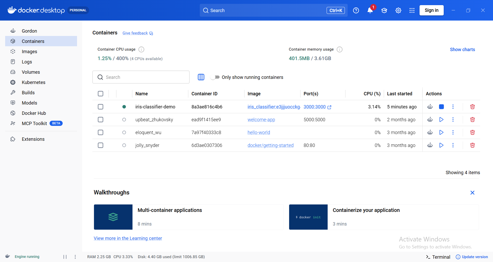

# 🌸 Iris Classification API with BentoML and Docker

A machine learning project that classifies Iris flowers using **Python, Scikit-learn, BentoML, and Docker**. The model is exposed through a REST API so users can submit flower measurements and receive a predicted class.

## 📌 Project Overview

This project demonstrates a basic machine learning deployment workflow:

1. Train an Iris classification model.
2. Serve the model through a BentoML API.
3. Send measurements to the `/classify` endpoint.
4. Package the service for container-based deployment with Docker.

The project is intended as a practical introduction to model serving and MLOps fundamentals.

## ✨ Features

- Trains a machine learning model on the Iris dataset.
- Exposes predictions through a BentoML API.
- Includes a `POST /classify` endpoint for inference.
- Includes a test script for checking the project.
- Provides Docker support for containerizing the service.

## 🛠️ Tech Stack

| Technology | Purpose |
| --- | --- |
| Python | Application and model code |
| Scikit-learn | Iris classification model |
| BentoML | Model serving and API |
| Docker | Containerization |
| Git and GitHub | Version control and project hosting |

## 📂 Project Structure

```text
MLService/
├── screenshots/
│   ├── iris-api-prediction.png
│   ├── iris-api-docs.png
│   └── iris-docker-container.png
├── train.py
├── test.py
├── service.py
├── bentofile.yaml
├── requirements.txt
├── .gitignore
├── .bentoignore
└── README.md
```


*The tree above reflects the structure documented for this project. Run commands from the directory containing these files.*

## ⚙️ Setup

### 1. Check Python and pip

```powershell
python --version
python -m pip --version
```

### 2. Create a virtual environment

```powershell
python -m venv venv
```

Activate it on Windows PowerShell:

```powershell
.\venv\Scripts\Activate.ps1
```

On macOS or Linux:

```bash
source venv/bin/activate
```

### 3. Install dependencies

```powershell
python -m pip install --upgrade pip
python -m pip install -r requirements.txt
```
## 🧠 Train the Model

Run the training script:

```powershell
python train.py
```

The script loads the Iris dataset, trains a Scikit-learn Support Vector Machine (SVM) classifier, and saves the trained model to BentoML's local model store.

Ensure training completes successfully before starting the API.

## 🧪 Test a Prediction

The `POST /classify` endpoint accepts four numeric flower measurements in this order:

1. Sepal length (cm)
2. Sepal width (cm)
3. Petal length (cm)
4. Petal width (cm)

**Example request body:**

```json
[[5.1, 3.5, 1.4, 0.2]]
```

**Example response:**

```json
[0]
```

The result is a predicted class index:

- `0` — Setosa
- `1` — Versicolor
- `2` — Virginica

These labels correspond to the standard Scikit-learn Iris dataset.
## 🌐 Start the BentoML API

Run the service from the project directory:

```bash
bentoml serve service:svc
```

When the service starts, open:

**http://localhost:3000**

Use the BentoML API documentation to inspect and try the `POST /classify` endpoint.

> If BentoML reports that `service:svc` cannot be found, check that `service.py` defines a service object named `svc` and that the command is being run from the project directory.


## 🐳 Docker

Docker can package the service and its dependencies into a container. First, check that Docker is installed and running:

```bash
docker --version
docker ps
```

If your `bentofile.yaml` is configured for this service and the required model artifacts are available, build the Bento:

```bash
bentoml build
```

Then use the BentoML containerization command with the Bento tag printed by the build step:

```bash
bentoml containerize <bento-name>:<version>
```

Replace `<bento-name>:<version>` with the actual tag shown in your terminal. Follow the generated image name and port configuration when starting the container; these depend on the BentoML configuration and image tag used for your build.

## 📚 Key Learnings

- Training a classification model with Scikit-learn.
- Serving model predictions through a REST API.
- Defining and running a BentoML service.
- Testing an inference endpoint.
- Understanding the role of Docker in packaging ML applications.
  

## 📸 Project Screenshots

### 1. Iris Classification API Prediction

The API successfully returns HTTP 200 with prediction class index `0`.



### 2. BentoML API Documentation

The API documentation displays the `/classify` endpoint and its expected input format.



### 3. Docker Container

Docker Desktop showing the `iris-classifier-demo` container running with port mapping `3000:3000`.



## 🔗 Repository

[View the Iris Classification API on GitHub](https://github.com/skhumera0202/bentoml-iris-classifier)

## 👩‍💻 Author

**Humera Shaikh**

This project demonstrates practical learning in machine learning deployment and MLOps.

---

⭐ If you find this project useful, feel free to explore the repository.
